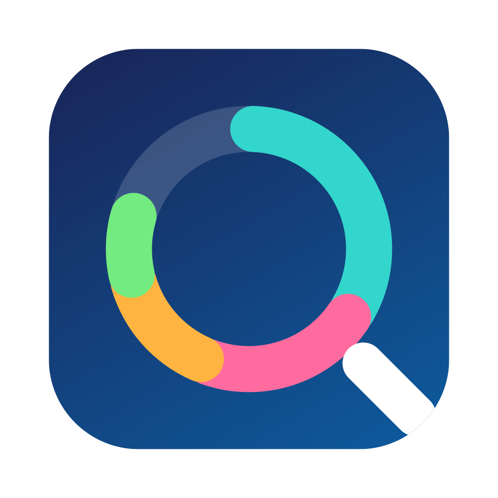
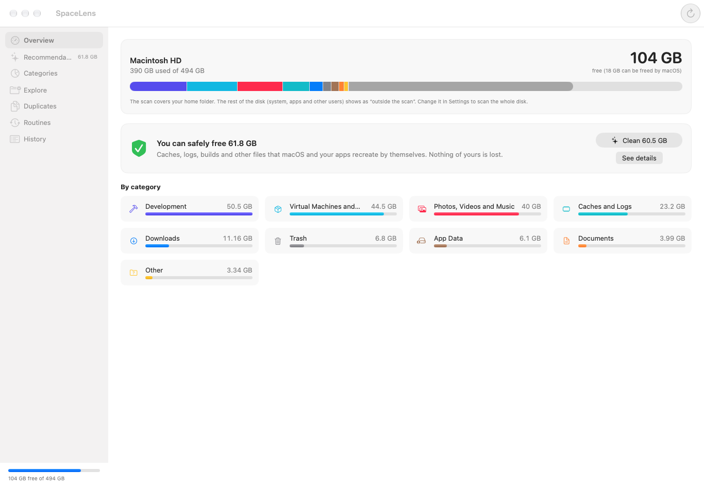
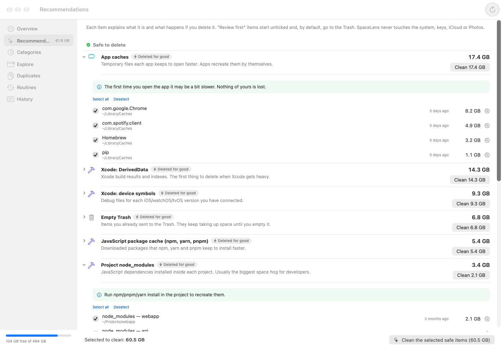
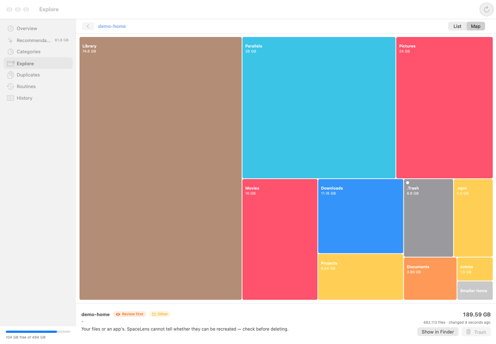
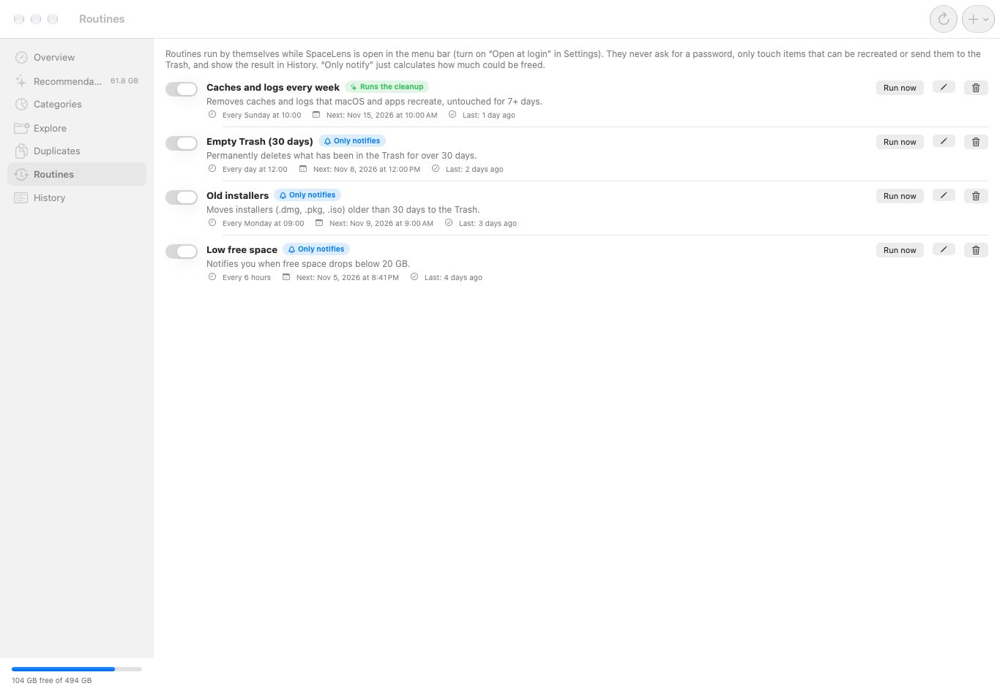
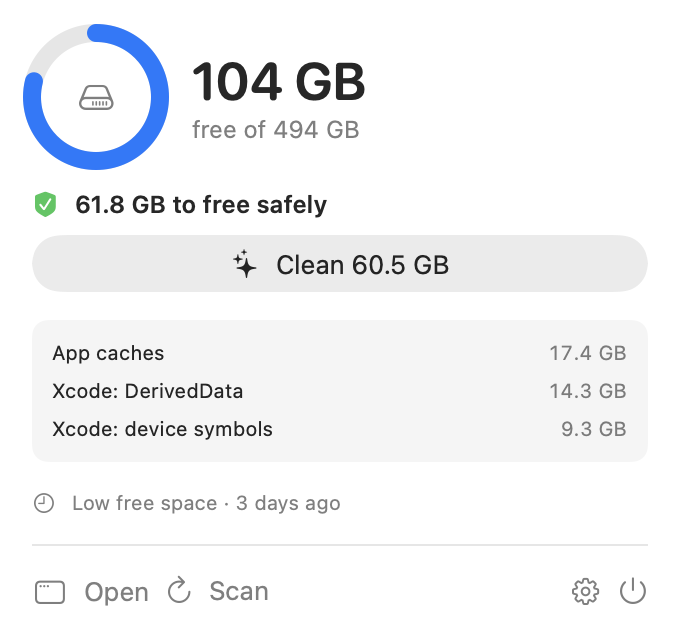

<p align="center">
  
</p>

<h1 align="center">SpaceLens</h1>

<p align="center">
  <a href="https://github.com/evertonfxavier/space-lens-mac/actions/workflows/ci.yml"></a>
  <a href="https://github.com/evertonfxavier/space-lens-mac/releases/latest"></a>
  <a href="LICENSE"></a>
</p>

A native macOS app (SwiftUI + AppKit) that shows **what is using your storage**, tells you **what you can and cannot delete**, groups everything **by category**, runs **scheduled cleanups** and lives in the **menu bar**.
One app, two faces: the main window and a menu bar item (free space next to the icon, red when it runs low).

> 🇧🇷 [Leia em português](README.pt-BR.md)



## Install

Download the latest `.dmg` (or `.zip`) from the [Releases](https://github.com/evertonfxavier/space-lens-mac/releases/latest) page and drag **SpaceLens** to Applications. Universal binary (Apple silicon + Intel), macOS 14 or later, no dependencies.

The app is not notarized (no paid Apple Developer account behind it), so macOS blocks the first launch:

- **System Settings → Privacy & Security → Open Anyway**, or
- `xattr -dr com.apple.quarantine /Applications/SpaceLens.app`

Then grant **Full Disk Access** (System Settings → Privacy & Security) so SpaceLens can see Mail, Messages, Safari and the Trash. Without it the app tells you how much was left out. Because the release is ad-hoc signed, macOS asks for this permission again after each update.

Prefer to build it yourself? See [below](#build-from-source).

## What it does

| Screen | Purpose |
|---|---|
| **Overview** | Disk bar split by category, how much can be freed safely, one-click quick clean |
| **Recommendations** | Each item explains *what it is* and *what happens if you delete it*, with a **Can delete / Review first / Keep** badge |
| **Categories** | Caches, Development, Trash, Downloads, Media, Documents, Apps, App data, Messages, Backups, VMs/Docker, Cloud, System |
| **Explorer** | List by size and a **treemap**, with the classification of every folder and file |
| **Duplicates** | Same content (size → fingerprint → SHA-256), always keeps the oldest copy |
| **Routines** | Scheduled (every N hours, daily, weekly, monthly), "only notify" or "run", with history |
| **History** | Everything that was freed, manually or by a routine |

It recognizes app and system caches, Xcode (DerivedData, device support, Archives, simulators), npm/yarn/pnpm, Cargo, Gradle, Maven, NuGet, Go, Conda, nvm/pyenv/rustup versions, `node_modules` / `target` / `Pods` / `.venv` / `bin`+`obj` and similar **only when a project file sits next to them**, Docker, local Time Machine snapshots, the Trash, old installers in Downloads, iPhone backups, Messages attachments, and large files untouched for 6+ months.

<p>
  
  
</p>
<p>
  
  
</p>

(Screenshots use demo data.)

## Language, menu bar and updates

- **Language:** English, Portuguese or Spanish, or *Automatic* to follow the macOS language. It changes the whole app on the spot (Settings → Language).
- **Menu bar:** the menu bar icon and its panel can be switched off (Settings → Menu bar). Without it SpaceLens stays in the Dock.
- **Updates:** SpaceLens tells you inside the app when a newer [release](https://github.com/evertonfxavier/space-lens-mac/releases) exists: a banner in the window and a line in the menu bar panel. It never installs anything by itself; **Download** opens the installer in your browser. The check can be turned off (Settings → Updates).

## Passwords and Touch ID

- **Before cleaning** (setting, on by default): Touch ID, Apple Watch or your Mac password through `LocalAuthentication`. When off, an alert lists what will be removed.
- **System items** (`/Library/Caches`, logs, Time Machine snapshots): macOS shows its administrator dialog where you type your password or use Touch ID. One prompt per cleanup. SpaceLens never sees or stores the password.
- **Routines never ask for a password**: they skip system items.

## Safety

- `SafetyGuard` is the last barrier before anything is removed. It canonicalizes the path (`..`, symlinked parents) and refuses the root, the system, `~`, `~/Library`, whole Documents/Desktop/Downloads, `.ssh`, keys, iCloud/cloud storage, Mail and Photos libraries. Things you pick yourself only go to the **Trash**.
- Only `/Library/Caches`, `/Library/Logs`, `/Library/Updates` and `/private/var/log` can be deleted as administrator.
- Nothing about your files leaves your machine. The only network request is the optional update check: one anonymous `GET` to `api.github.com/repos/evertonfxavier/space-lens-mac/releases/latest` once a day, which you can turn off in Settings. There is no telemetry.
- "Review first" items start **unticked** and go to the Trash. Projects touched in the last 30 days start unticked.

Found a way around it? Please report it privately, see [SECURITY.md](SECURITY.md).

## Build from source

```bash
make run        # build and open
make install    # copy to /Applications
make check      # lint + tests + build
make test       # Swift Testing suites on real temporary directories
make snapshots  # screenshots with demo data in build/snapshots (development build)
make screenshots  # regenerate the README screenshots (English and Portuguese)
make dmg        # build/dist/SpaceLens-<version>.dmg (also: make zip, make universal, make release-local)
```

There is no Xcode project and no SwiftPM manifest on purpose: `scripts/build.sh` uses `swiftc` only, so it works with just the Command Line Tools. If the newest SDK cannot compile `@State` (missing SwiftUIMacros plugin), the script falls back to the macOS 26 SDK by itself.

```
Sources/SpaceLens/
  Core/      everything that is not UI (Scan, Catalog, Safety, Actions, Duplicates, Treemap, Routines, Persistence, System)
  UI/        SwiftUI views
  App/       AppModel, AppDelegate (window + menu bar item), main
  Dev/       demo data and screenshots, only with SNAPSHOT_TOOLS=1
Tests/       Swift Testing on real temporary directories
scripts/     build, test, package, icon
```

`scripts/test.sh` compiles only `Core` + `Tests`, so `Core` cannot depend on the UI. Data lives in `~/Library/Application Support/SpaceLens` (settings, routines, history, last scan summary).

## Releases

Fully automated. Bump `VERSION`, add the `## [x.y.z]` section to [CHANGELOG.md](CHANGELOG.md) and merge to `main`: the [Release workflow](.github/workflows/release.yml) tests, builds a universal binary and publishes the GitHub release with the dmg, the zip and `SHA256SUMS.txt`.

## Contributing

Issues and pull requests are welcome, see [CONTRIBUTING.md](CONTRIBUTING.md).

## License

[MIT](LICENSE)
