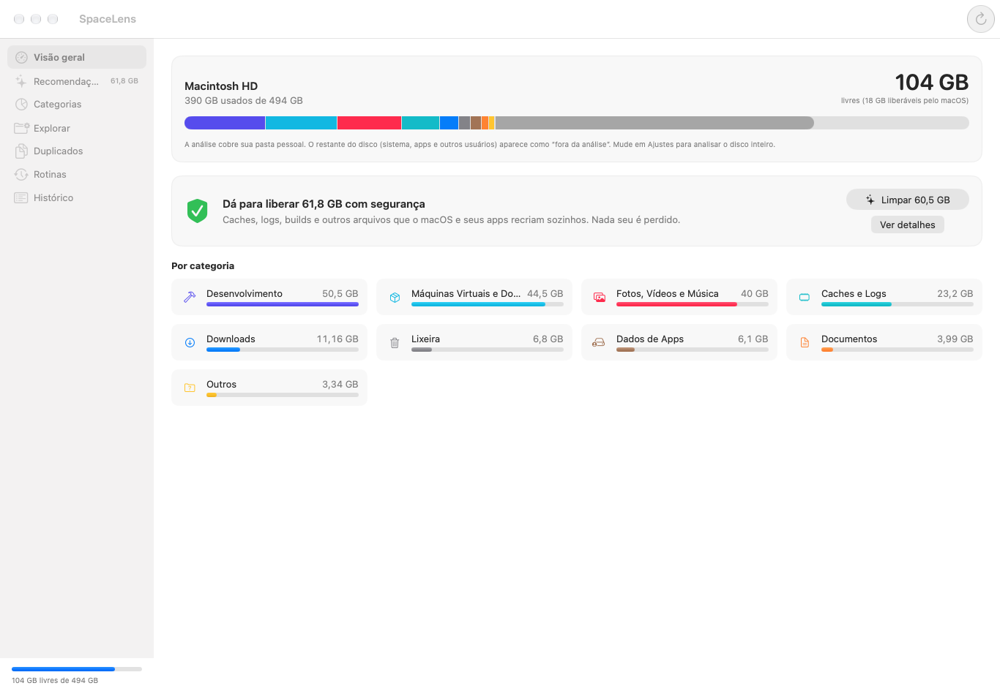
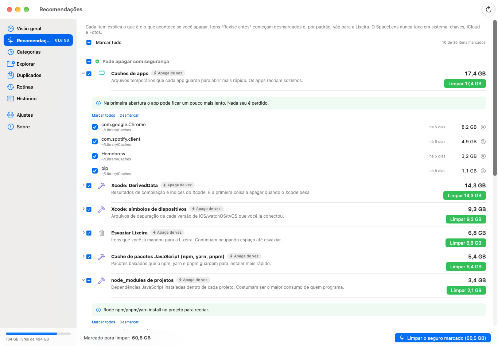
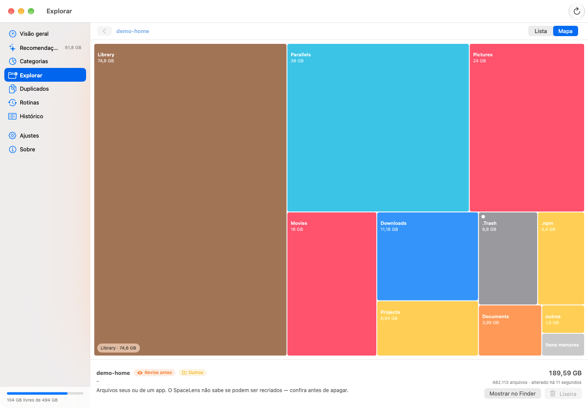
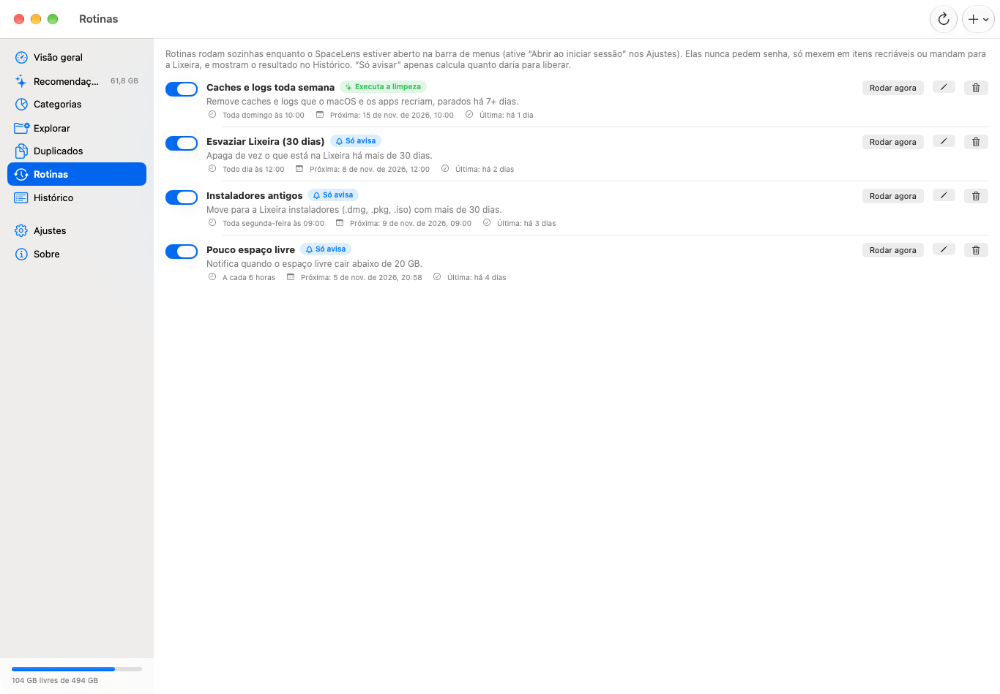
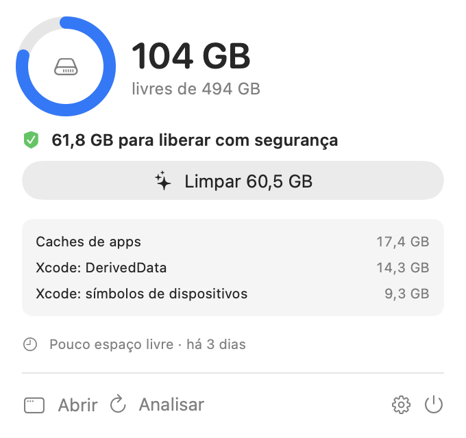

<p align="center">
  
</p>

<h1 align="center">SpaceLens</h1>

> 🇺🇸 [Read in English](README.md)

App nativo para macOS (SwiftUI + AppKit) que mostra **o que consome seu armazenamento**, diz **o que pode ou não ser apagado**, separa tudo **por categoria**, roda **rotinas de limpeza** e vive na **barra de menus**.
Um único app com duas faces: a janela principal e o ícone na barra de menus (espaço livre ao lado do ícone, vermelho quando está acabando).



<p>
  
  
</p>
<p>
  
  
</p>

(As capturas usam dados de demonstração.)

## Usar

```bash
make run        # compila e abre
make install    # copia para /Applications (recomendado para Acesso Total ao Disco e "abrir ao iniciar sessão")
make check      # lint + testes + build
make snapshots  # capturas das telas com dados de demonstração em build/snapshots (build de desenvolvimento)
make dmg        # build/dist/SpaceLens-<versão>.dmg (ou: make zip, make universal, make release-local)
```

Sem SwiftPM de propósito: ele não avalia manifestos com as Command Line Tools locais. `scripts/build.sh` usa só `swiftc`.
Se o SDK mais novo não compilar `@State` (falta o plugin SwiftUIMacros nas CLT), o script usa sozinho o SDK macOS 26.

## O que faz

| Tela | Para quê |
|---|---|
| **Visão geral** | Barra do disco dividida por categoria, quanto dá para liberar com segurança e botão de limpeza rápida |
| **Recomendações** | Cada item explica *o que é* e *o que acontece se apagar*, com selo **Pode apagar / Revise antes / Não apague** |
| **Categorias** | Caches, Desenvolvimento, Lixeira, Downloads, Mídia, Documentos, Apps, Dados de Apps, Mensagens, Backups, VMs/Docker, Nuvem, Sistema |
| **Explorar** | Lista por tamanho e **mapa (treemap)**, com a classificação de cada pasta e arquivo |
| **Duplicados** | Mesmo conteúdo (tamanho → impressão digital → SHA-256), mantém a cópia mais antiga |
| **Rotinas** | Agendadas (a cada N horas, diária, semanal, mensal), "só avisar" ou "executar", com histórico |
| **Histórico** | Tudo que foi liberado, manual ou por rotina |

Reconhece: caches de apps e do sistema, Xcode (DerivedData, símbolos de dispositivos, Archives, simuladores), npm/yarn/pnpm, Cargo, Gradle, Maven, NuGet, Go, Conda, versões de nvm/pyenv/rustup, `node_modules`/`target`/`Pods`/`.venv`/`bin`+`obj` etc. **só quando há um arquivo de projeto ao lado**, Docker, instantâneos locais do Time Machine, Lixeira, instaladores antigos em Downloads, backups de iPhone, anexos do Mensagens, arquivos grandes parados há 6+ meses.

## Idioma, barra de menus e atualizações

- **Idioma:** português, inglês ou espanhol, ou *Automático* para seguir o idioma do macOS. Muda o app inteiro na hora (Ajustes › Idioma).
- **Barra de menus:** dá para desligar o ícone e o painel da barra de menus (Ajustes › Barra de menus). Sem eles o SpaceLens fica no Dock.
- **Atualizações:** o SpaceLens avisa dentro do app quando existe uma [release](https://github.com/evertonfxavier/space-lens-mac/releases) mais nova: um aviso na janela e uma linha no painel da barra de menus. Ele nunca instala nada sozinho; **Baixar** abre o instalador no navegador. A verificação pode ser desligada (Ajustes › Atualizações).

## Senha e digital

- **Antes de limpar** (ajuste, ligado por padrão): Touch ID, Apple Watch ou senha do Mac, pela `LocalAuthentication`. Desligado, aparece um alerta dizendo o que será removido.
- **Itens de sistema** (`/Library/Caches`, logs, instantâneos do Time Machine): o macOS abre o diálogo de administrador, onde você digita a senha ou usa a digital. É **um único pedido por limpeza**. O SpaceLens nunca vê nem guarda a senha.
- **Rotinas nunca pedem senha**: pulam itens de sistema.

## Segurança

- `SafetyGuard` é a última barreira antes de apagar: canonicaliza o caminho (`..`, symlinks nos pais), recusa raiz, sistema, `~`, `~/Library`, Documentos/Mesa/Downloads inteiros, `.ssh`, chaves, iCloud/nuvem, Mail e bibliotecas do Fotos. Itens escolhidos por você só vão para a **Lixeira**.
- Só `/Library/Caches`, `/Library/Logs`, `/Library/Updates` e `/private/var/log` podem ser apagados como administrador.
- Nada sobre seus arquivos sai da sua máquina. A única requisição de rede é a verificação opcional de atualização: um `GET` anônimo para `api.github.com/repos/evertonfxavier/space-lens-mac/releases/latest` uma vez por dia, que você pode desligar nos Ajustes. Não há telemetria.
- Itens "Revise antes" começam **desmarcados** e vão para a Lixeira. Projetos mexidos nos últimos 30 dias começam desmarcados.

## Permissões do macOS

Para ver Mail, Mensagens, Safari e Lixeira, dê **Acesso Total ao Disco** ao SpaceLens (Ajustes do Sistema › Privacidade e Segurança). Sem isso o app avisa e mostra quanto ficou de fora. App assinado ad-hoc perde essa permissão a cada recompilação; com `SIGN_IDENTITY` de um certificado próprio ela persiste.

## Estrutura

```
Sources/SpaceLens/
  Core/      tudo que não é tela (Scan, Catalog, Safety, Actions, Duplicates, Treemap, Routines, Persistence, System)
  UI/        views SwiftUI
  App/       AppModel, AppDelegate (janela + ícone na barra de menus), main
  Dev/       demo e capturas, só com SNAPSHOT_TOOLS=1
Tests/       Swift Testing, usando disco real em pastas temporárias
scripts/     build, testes, ícone
```

`scripts/test.sh` compila só `Core` + `Tests`, então o Core não consegue depender da UI.
Dados em `~/Library/Application Support/SpaceLens` (ajustes, rotinas, histórico, resumo da última análise).

## Instalar sem compilar

Baixe o `.dmg` em [Releases](https://github.com/evertonfxavier/space-lens-mac/releases/latest). O app não é notarizado: no primeiro uso vá em **Ajustes do Sistema › Privacidade e Segurança › Abrir mesmo assim**, ou rode `xattr -dr com.apple.quarantine /Applications/SpaceLens.app`.

## Releases

Totalmente automáticas. Cada push na `main` é lido pelo workflow *Release*: commits `feat:` sobem a versão minor, `fix:` / `perf:` / `refactor:` a patch, mudanças que quebram compatibilidade a major, e `docs:` / `chore:` / `ci:` / `test:` não geram release. Quando há release, ele atualiza o `VERSION` e o `CHANGELOG.md` a partir das mensagens de commit, testa, compila um binário universal e publica a release com dmg, zip e `SHA256SUMS.txt`. Detalhes em [CONTRIBUTING.md](CONTRIBUTING.md#releasing).
